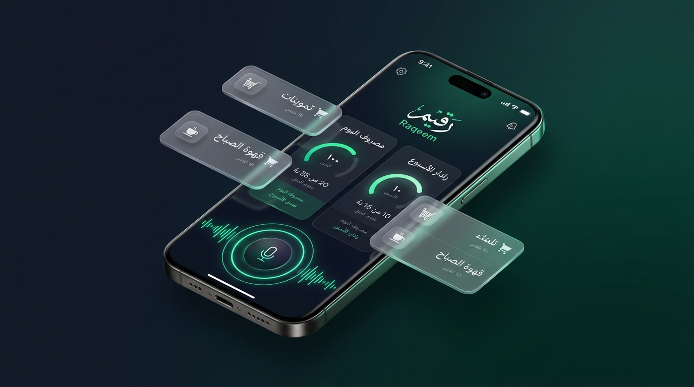

# رقيم — Raqeem 🎙️💳
### متتبع المصاريف اليومية والأسبوعية الذكي (Arabic-first & Voice-first Expense Tracker)



<div align="center">


<br/>

[](https://kotlinlang.org/)
[](https://www.jetbrains.com/lp/compose-multiplatform/)
[](https://deepmind.google/technologies/gemini/)
[](https://developer.android.com/)
[](#اختبارات-الجودة)

</div>

---

## 1. الفكرة والرؤية (Project Vision)
**رقيم (Raqeem)** يحل المعضلة الكبرى في إدارة المال اليومي: **إحباط وملل الإدخال اليدوي**.  
عبر تجربة **"سجّل بصوتك في 5 ثوانٍ، والباقي علينا"**، يتحدث المستخدم بعفوية بلهجته الدارجة، ليتولى نموذج **Google Gemini 2.5 Flash** تفكيك المشتريات، استخراج المبالغ، تصنيف الفئات، وتحديد من دفع ولمن بدقة فائقة وعرضها في بطاقة تأكيد بلمسة واحدة.

---

## 2. سلسلة عمل الـ AI SDLC (Spec Kit Methodology)
تم بناء المشروع وفق معايير [GitHub Spec-Kit](https://github.com/github/spec-kit) المنضبطة:
```text
AGENTS.md ──► intent.md ──► spec.md ──► plan.md ──► tests ──► code ──► review
```
- **[`AGENTS.md`](./AGENTS.md)**: ميثاق سرب الوكلاء المتخصصين وقواعد العزل المعماري.
- **[`intent.md`](./intent.md)**: بيان المشكلة، ونطاق الـ MVP، ومؤشرات النجاح.
- **[`spec.md`](./spec.md)**: عقود البيانات، ومخطط الـ JSON Schema لـ Gemini، وسيناريوهات القبول.
- **[`plan.md`](./plan.md)**: خطة المراحل الفنية الخمس من M1 إلى M5.
- **[`review.md`](./review.md)**: التقرير الشامل لتدقيق الأمان (Security)، واستهلاك الذاكرة، ومعايير WCAG 2.2.

---

## 3. سرب الوكلاء المتخصصين (Multi-Agent Swarm)
تم توزيع العمل بين وكلاء متخصصين في Antigravity:
1. **`@ux-designer`**: بناء نظام تصميم عربي RTL كامل بأسلوب Fintech داكن فاخر، وزر الصوت التفاعلي بنبض الموجة الحية، مسترشداً بـ `ui-ux-pro-max` و `compose-ui`.
2. **`@kmp-engineer`**: معمارية MVI النظيفة (`ExpenseContract`, `ExpenseViewModel`) وعقود `expect/actual` لتسجيل الصوت عبر `MediaRecorder` و AAC.
3. **`@ai-specialist`**: هندسة برومبت فهم اللهجات والمصطلحات المالية في `GeminiPromptBuilder` وبناء عميل `GeminiApiClient` السحابي والمحلي.
4. **`@db-architect`**: تصميم مستودع البيانات `ExpenseRepository` كـ Single Source of Truth مع حساب تحليلات الأسبوع وتوزيع الدافعين.
5. **`@qa-tester`**: كتابة 14 اختبار وحدة تلقائي (Unit Tests) بنسبة نجاح 100% عبر `tdd-orchestrator`.
6. **`@security-perf`**: تأمين الميكروفون ضد تسريب الذاكرة، عزل مفاتيح الـ API، وضبط قواعد ProGuard / R8.

---

## 4. الميزات التقنية الرئيسية
- 🎙️ **التسجيل الصوتي العفوي:** فهم مباشر للهجات (السعودية، المصرية، الشامية، الخليجية) مع تحليل تلقائي للمصروفات المتعددة.
- 📩 **قارئ إشعارات البنوك (Bank SMS):** إمكانية لصق رسائل الخصم البنكية واستخراج المبالغ والجهات وتصنيفها فوراً.
- 👥 **قسم "مين دفع ومين عليه":** كشف حساب فوري للمصاريف المشتركة وتوزيع المبالغ بين الأشخاص.
- 📊 **رادار الموازنة الأسبوعي:** مؤشر بصري ملون يوضح المتبقي من ميزانية الأسبوع ونسبة الصرف.
- ⚡ **سحابي + وضع محلي فوري (Offline-First):** يعمل بكامل طاقته محلياً حتى في حال انقطاع الإنترنت أو عدم توفر مفتاح API.

---

## 5. التشغيل والتجربة في Android Studio 📱
1. افتح مجلد المشروع في **Android Studio**.
2. اختر من القائمة العلوية Run Configuration باسم **`androidApp`**.
3. وصّل هاتفك الأندرويد عبر الـ USB أو شغّل المحاكي (Emulator).
4. اضغط على زر **Run ▶**:
   - **لتسجيل المصاريف بالصوت:** اضغط على زر الميكروفون وتكلم بحرية ثم اضغط إيقاف لمراجعة وتأكيد البنود المستخرجة.
   - **لقراءة إشعارات البنوك:** اضغط على أيقونة `📩` العلوية والصق نص الرسالة.
   - **لإعداد السحابة:** اضغط على أيقونة `⚙️` وأدخل مفتاح Gemini API Key لتفعيل المعالجة السحابية المباشرة عبر **Gemini 2.5 Flash**.

---

## 6. أوامر البناء والاختبار عبر السطر البرمجي (CLI)
- **بناء تطبيق الأندرويد:**
  ```powershell
  .\kotlin.bat build -m androidApp
  ```
- **تشغيل حزمة الاختبارات الآلية:**
  ```powershell
  .\kotlin.bat test -m shared
  ```
