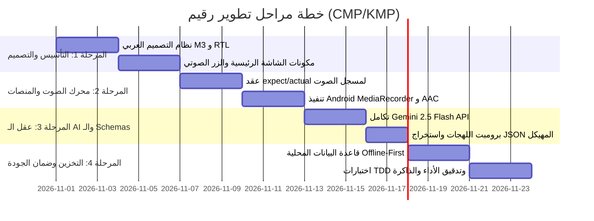

# خطة التنفيذ الفنية (plan.md) — تطبيق "رقيم Raqeem"

## 1. ملخص المراحل (Milestones Overview)

---

## 2. تفصيل المهام والمسؤولين في السرب (Detailed Tasks Breakdown)

### المرحلة 1: نظام التصميم والواجهات المشتركة (المسؤول: `@ux-designer`)
- [ ] **M1.1**: إعداد ثيم Material 3 يدعم الاتجاه الكامل من اليمين لليسار (`LayoutDirection.Rtl`).
- [ ] **M1.2**: تجهيز لوحة ألوان مستوحاة من نمط Fintech الفاخر (Dark Slate / Deep Emerald Green للوفر والمصروفات).
- [ ] **M1.3**: تصميم زر الميكروفون التفاعلي مع تأثير الحركة النبضية (Pulsing Waveform Animation) أثناء التسجيل.
- [ ] **M1.4**: تصميم بطاقة التأكيد المنبثقة (Review Bottom Sheet) لمراجعة بنود المصروفات بلمسة واحدة.

### المرحلة 2: محرك تسجيل الصوت متعدد المنصات (المسؤول: `@kmp-engineer`)
- [ ] **M2.1**: إنشاء عقد `expect class AudioRecorder` في موديول `shared/src/commonMain`.
- [ ] **M2.2**: تنفيذ مسجل الصوت في `shared/src@android` باستخدام `MediaRecorder` المدمج بصيغة AAC عالية الضغط.
- [ ] **M2.3**: إضافة أذونات الميكروفون `android.permission.RECORD_AUDIO` في `androidApp/src/AndroidManifest.xml` ومعالجة طلب الإذن أثناء التشغيل (Runtime Permissions).
- [ ] **M2.4**: توفير تدفق سعة الصوت `StateFlow<Float>` لتحديث واجهة المستخدم بالموجة الصوتية الحية.

### المرحلة 3: تكامل الذكاء الاصطناعي مع Gemini 2.5 Flash (المسؤول: `@ai-specialist`)
- [ ] **M3.1**: بناء عميل `GeminiApiClient` باستخدام `Ktor HTTP Client` للاتصال المباشر بنموذج `gemini-2.5-flash`.
- [ ] **M3.2**: صياغة System Instruction المتخصص في فهم اللهجات العربية والمصطلحات المالية ("قطية"، "حاسبت"، "بنزين"، "عشى").
- [ ] **M3.3**: تفعيل المخرجات المهيكلة بتمرير `response_mime_type: "application/json"` و `response_schema`.
- [ ] **M3.4**: إضافة معالج بديل لإشعارات البنوك (SMS Text أو Screenshot OCR).

### المرحلة 4: قاعدة البيانات وإدارة الحالة (المسؤول: `@db-architect` و `@kmp-engineer`)
- [ ] **M4.1**: إعداد `ExpenseRepository` المحلي مع دعم الحفظ الفوري والاستعلام عن إجمالي اليوم ومجموع الأسبوع.
- [ ] **M4.2**: ربط دورة الـ MVI في `ExpenseViewModel`:
  - `ExpenseIntent.StartRecording`
  - `ExpenseIntent.StopAndProcessVoice`
  - `ExpenseIntent.ConfirmExpenseBatch`
  - `ExpenseIntent.DeleteExpenseItem`
- [ ] **M4.3**: وضع آلية حفظ مسودة الصوت في حال عدم وجود اتصال لإعادة إرسالها تلقائياً.

### المرحلة 5: الاختبارات والأداء والأمان (المسؤول: `@qa-tester` و `@security-perf`)
- [ ] **M5.1**: كتابة Unit Tests لمنطق فك تشفير JSON إلى كائنات Kotlin والتحقق من المبالغ والتصنيفات.
- [ ] **M5.2**: فحص عدم وجود تسريب للذاكرة عند فتح وغلق الميكروفون عدة مرات.
- [ ] **M5.3**: عزل الـ API Keys في ملف `local.properties` أو البيئة الآمنة لمنع تسريبها.
- [ ] **M5.4**: تجربة التشغيل الفعلي على محاكي Android وجهاز حقيقي عبر Android Studio.

